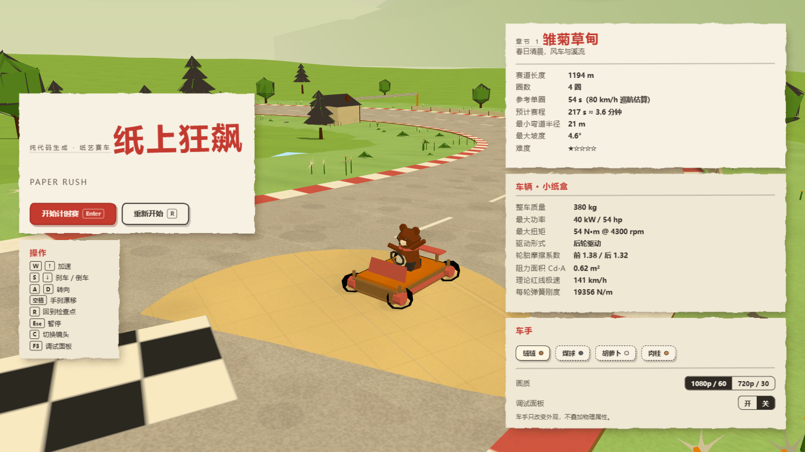
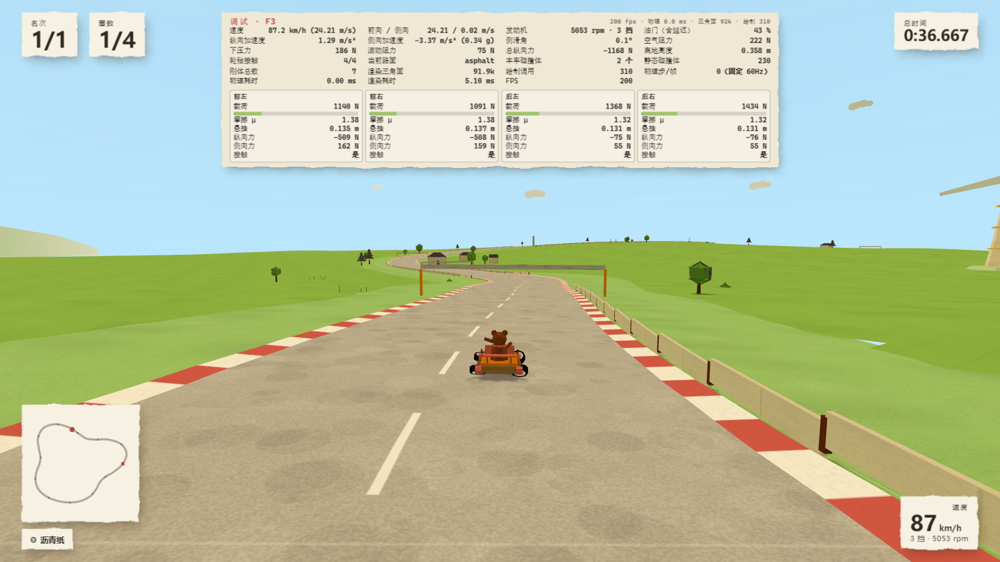
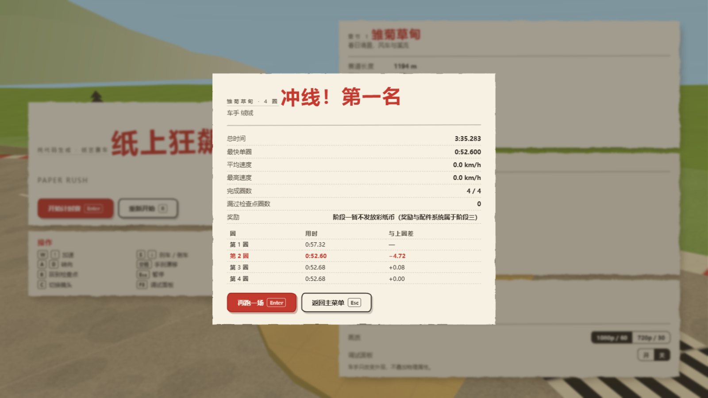

# 纸上狂飙 Paper Rush

> 一个纯代码生成的 3D 纸艺赛车游戏。没有外部模型、贴图、音频素材、CDN 或付费服务——
> 所有可见几何、纹理、界面与音效都在运行时由代码生成。

技术栈：**TypeScript + Three.js（渲染）+ Rapier 3D（物理）+ Vite（构建）**。
浏览器优先，构建产物可离线运行。

**当前状态：阶段一（技术启动与驾驶原型）已完成并通过验收**，可实际游玩 4 圈计时赛。
进度与缺口见 [开发进度.md](./开发进度.md)。



---

## 快速开始

```bash
npm install
npm run dev      # http://127.0.0.1:5173/
npm run build    # 类型检查 + 生产构建到 dist/
npm run test     # 33 个自动化测试
```

要求 Node ≥ 22.12（在 Node 24.12 / npm 11.6 上验证）。

## 操作

| 按键 | 作用 |
| --- | --- |
| `W` / `↑` | 加速 |
| `S` / `↓` | 刹车；低速继续按可倒车 |
| `A` `D` / `←` `→` | 转向 |
| `空格` | 手刹（可控制漂移） |
| `R` | 回到最近检查点（不重置成绩） |
| `Esc` | 暂停 / 继续 / 返回 |
| `C` | 切换镜头 |
| `F3` | 调试面板（真实物理量遥测） |
| `M` | 静音 / 恢复声音 |

---

## 它不是"看起来像赛车"

车辆的每一分运动都由 Rapier 官方动态射线车辆控制器求解：车轮射线、悬挂弹簧与阻尼、
转向几何、侧向轮胎力、刚体积分与碰撞全部由物理引擎负责。项目代码只负责
发动机扭矩曲线→轮端牵引力、制动分配、轮胎摩擦圆、空气阻力/下压力/滚阻、按路面切换摩擦系数，
并且这些力都通过 Rapier 施加到刚体——没有第二套侧向抓地系统，也没有任何
"每帧改写世界坐标"的假行驶。

固定 60 Hz 物理步进、渲染插值，相同输入在任何帧率下产生**逐位相同**的结果（有测试）。

### 实测数据（真实物理求解，非估算）

| 项目 | 实测值 |
| --- | --- |
| 0–100 km/h | 8.70 s |
| 极速 | 141.0 km/h（3 挡红线限制，与理论值一致） |
| 制动 140 → 0 km/h | 2.95 s，平均 13.14 m/s²（1.34 g，轮胎 μ 上限 1.38） |
| 侧向 μ 实测 | 1.34（参数 前 1.38 / 后 1.32） |
| 稳态满转向绕圈 | 1.39 g，半径 18.4 m，不翻车 |
| 摩擦圆代价 | 直线制动 13.14 → 边转向边制动 7.29 m/s² |
| 空气阻力 40:20 m/s 比值 | 4.00（理论 4.00） |
| 草地 vs 沥青 0–60 km/h | 4.18 s vs 3.50 s |
| 满打方向 60 km/h | 峰值侧滑角 **3.2°**、1.16 g 过弯、不失控（推头而非甩尾） |
| 手刹漂移 | 峰值侧滑角 84°，松开 2 s 内恢复抓地（漂移是主动操作） |
| 倒挡 / 8% 坡道驻车 | 倒挡可用；拉手刹 5 s 滑 0.23 m，不拉则滑 10.8 m |

**制动受附着力限制而不是受制动力限制**——加大刹车不会让车停得更快。



*调试面板中的每一个数字都来自物理求解：逐轮载荷、摩擦系数、悬挂长度、纵向/侧向力、外力分解。*

---

## 全部声音也是代码生成的

没有引入任何外部录音。引擎是两个失谐锯齿波 + 低通（频率跟转速、音量跟油门），
轮胎滑移是带通白噪声（跟滑移量），风噪跟车速，碰撞由速度骤降触发，
背景音乐是程序生成的和弦 + 琶音——在音频时钟上提前排程，不阻塞物理循环。
音乐、音效、静音可独立控制。

## 赛道由配置数据 + 程序化生成

中心线是闭合 Catmull-Rom 样条，按弧长等距重采样；路面是从断面生成的**连续三角网格**
（真实支持高程，不是无限平面），地形是第二张网格，两者共用同一份顶点数据用于渲染与碰撞。

内置自检覆盖：自交、弯道半径、坡度、超高上限、护栏连续性、检查点顺序、赛程时长。

**雏菊草甸**：1194 m ｜ 最小弯道半径 21 m ｜ 最大坡度 4.6° ｜ 高程跨度 10.07 m ｜ 11 个检查点 ｜ 4 圈

真实浏览器完整比赛实测：单圈 57.32 / 52.60 / 52.68 / 52.68 s，**总时间 3:35.283**，
平均 80.0 km/h，漏检查点 0 圈，控制台零错误。



---

## 目录结构

```
src/
  game/       主循环、流程状态机、摄像机、输入、确定性随机
  physics/    Rapier 世界包装、固定步进、插值快照、碰撞分组与路面类型
  vehicles/   参数表、派生量、动力总成、车辆控制器、纸板车外观
  tracks/     中心线、路面/路堤/护栏几何、地形、赛道自检、赛道数据
  scenery/    程序化纸张纹理与材质、折纸场景件、赛道视图装配
  race/       倒计时、计圈、检查点、计时、重置、排名
  ui/         HUD、主菜单、结算、调试面板、纸艺样式
tests/        33 个用例（车辆物理 / 赛道几何 / 比赛流程）
tools/        赛道几何实验室（开发工具，不参与构建）
```

## 文档

- [项目说明.md](./项目说明.md) —— 运行方式、目录职责、关键实现说明、已知限制
- [开发进度.md](./开发进度.md) —— 阶段完成清单、验收实测证据、踩坑记录、下一步
- [玩法与平衡.md](./玩法与平衡.md) —— 物理模型与单位约定、实测性能、路面与赛道数据、调参经验

## 画质档位

高画质档：1080p、开启柔和阴影、像素比跟随设备（上限 2）。
低画质档：内部渲染分辨率 1280×720、关闭阴影、像素比 0.8 —— **已实测可正常运行、无报错**。

但低画质档**没有做过严格的画质/帧率对比与弱设备验证，因此不声称已达成 720p/30 目标**。
性能剖析与弱设备测试属于阶段五。

## 仍未完成

**没有 AI 对手**。这是与原计划的阶段三一起做的较大功能（AI 模块 + 名次系统 +
7 辆与玩家共用同一套物理的对手车），需要独立一轮实现，本轮先修完了影响可玩性的 bug
与美术问题，没有把它做成一个"看着有但其实在轨道上滑行"的假 AI。
